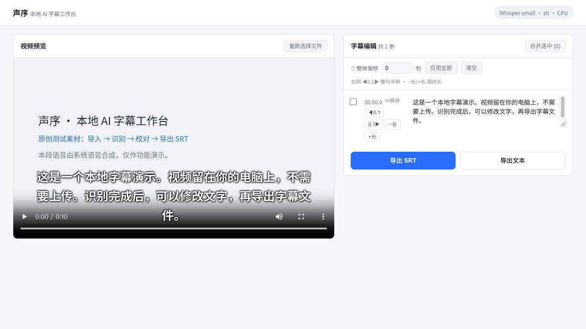

# Shengxu · Local AI Subtitle Workbench

[中文](README.md) · [Download ZIP](https://github.com/muzilun000-gif/local-ai-subtitle/archive/refs/heads/main.zip)

Import video/audio, transcribe locally with Whisper, correct text and timing, and export SRT or TXT. No account, telemetry, or cloud media upload. First setup downloads dependencies and a speech model; transcription can then work offline.



## Windows and macOS

Install Python 3.11 or 3.12 first (supported range: 3.10–3.13), download the ZIP and extract the complete folder. This is a source launcher, not a standalone EXE/DMG.

- **Windows:** double-click `start.bat`.
- **macOS:** run `start-mac.command`; if needed, run `chmod +x start-mac.command` in Terminal first.
- **Direct:** `python tools/launch.py` (macOS: `python3`; Windows can use `py -3.12`).

The first run creates a project-local virtual environment, installs dependencies including a bundled FFmpeg binary, and downloads the small model (~484MB). It then opens `http://127.0.0.1:8090/`. Stop with Ctrl+C. Keep the extracted folder writable. No Homebrew or system FFmpeg installation is required for this launcher.

Use `--model base` for a smaller model or `--port 8091` for a different port. Keep the first model download online; rerun after an interrupted download. Do not move virtual environments between computers. Keep your original media and exported subtitles backed up.

## Try the actual example

[Original synthetic-voice video](docs/demo-input.mp4) · [SRT exported after punctuation correction](docs/demo-output.srt).

Mac/Apple Silicon/Python 3.13 has passed a real import, recognition, edit, SRT and TXT export check. Windows CI is configured but has not run yet. No claim is made about every GPU, codec or editing application. Accuracy and speed depend on speech, model and hardware.

## Features

Local faster-whisper recognition; inline text correction; split/merge; timing adjustments; video preview; browser-local drafts; SRT/TXT export. Mac uses CPU int8; Windows can use CPU, with optional CUDA dependencies in backend/requirements-gpu.txt.

This repository contains the open-source basic version. Commercial/private project-management, translation and QA features are not included.

## Troubleshooting and development

Read the terminal error if installation fails, check network access, and rerun. The launcher checks service identity before opening a used port. PyAV is capped below 19 because version 19 breaks the current recognizer's audio API.

```sh
python tools/launch.py --setup-only --model tiny
# macOS
.venv/bin/python tools/smoke.py
# Windows
.venv\Scripts\python tools\smoke.py
```

The smoke check uploads real speech, checks recognition, edits text, and validates actual SRT/TXT bytes. [MIT](LICENSE) · [Privacy](PRIVACY.md) · [Dependency licenses](THIRD_PARTY_NOTICES.md).
